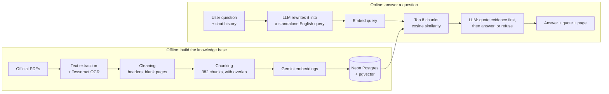

# Yojana Mitra (योजना मित्र) 🇮🇳

**Ask about Indian government schemes in Hinglish, Hindi, or English. Get a simple answer, the exact line from the official PDF, and the page number it came from.**

A RAG (Retrieval-Augmented Generation) app over official scheme documents. If the answer isn't in the documents, it says so instead of guessing.

🔗 **Live demo:** https://yojana-mitra-1-po1g.onrender.com
*(Free hosting: the first request can take ~50 seconds while the server wakes up.)*

<!-- Demo video: on github.com, edit this file and drag your .mov/.mp4 here. GitHub will insert a link that plays inline. -->

---

## What it does

| You ask | You get |
|---|---|
| *"kisaan ko saal mein kitna paisa milta hai?"* | "Rs. 6000 per year, in three installments of Rs. 2000" + the quoted line + **PM-KISAN FAQ, page 1** |
| *"aur kaun eligible nahi hai?"* (follow-up) | Understands you still mean PM-KISAN, and answers from the exclusion list |
| *"aur OBC ke liye?"* (not in the documents) | *"Mujhe yeh jaankari in documents mein nahi mili."* No made-up numbers |

**Documents covered (133 pages):**
- PM-KISAN Operational Guidelines (12 pages)
- PM-KISAN FAQ (9 pages, scanned, processed with OCR)
- PMAY-Urban 2.0 Scheme Guidelines (112 pages)

---

## How it works



**Key design choices**
- **Query rewriting:** Hinglish questions ("kisaan", "ghar", "shehar") retrieved the wrong documents. An LLM first turns each question, plus recent chat history, into one clear English search question.
- **Quote-first grounding:** the model must copy the exact supporting line (`EVIDENCE: "..." (Source: file, page N)`) *before* writing the answer. This stopped it from answering opposite to an exclusion list.
- **Explicit refusal:** if no retrieved line is related, the answer is a fixed refusal sentence, which the evaluation checks for.
- **Stateless API:** the frontend keeps the chat history and sends it with each request, so the backend stores nothing between requests.
- **LLM fallback chain:** if the primary model hits a rate limit, the next model in the list answers (`gpt-oss-120b → qwen3.8-27b → gpt-oss-20b`).

---

## Evaluation

A hand-written set of **24 questions**: 20 answerable (10 PM-KISAN, 10 PMAY-U) and 4 "trap" questions whose answers are not in the documents. For each question it checks:

- **Retrieval hit:** did the right PDF come back in the top chunks?
- **Answer correct:** does the answer contain the expected facts (numbers, key terms)?
- **Citation correct:** does it cite the right PDF?
- **Trap refused / false refusal:** does it refuse when it should, and only then?

| Version | Correct answers | Correct citation | Traps refused | False refusals |
|---|---|---|---|---|
| Baseline | 9 / 20 | 17 / 20 | 4 / 4 | 3 / 20 |
| Fixed evaluator (normalized text) | 14 / 20 | 18 / 20 | 4 / 4 | 2 / 20 |
| Quote-first prompt + top-8 retrieval | **16 / 20** | **19 / 20** | **4 / 4** | **1 / 20** |

*These scores were measured with the local `multilingual-e5-small` embedding model, before moving to Gemini embeddings for deployment. Re-running the evaluation on the deployed setup is the next step.*

Run it yourself: `python eval.py` (results are saved in `evals/`).

---

## Challenges I ran into

**Building the RAG pipeline**
- **Scanned PDF:** the PM-KISAN FAQ is an image. Tesseract OCR worked, but my first pass misread several words (even "PM-KISAN"); a fresh, cleaner OCR pass fixed them.
- **A "PDF" that wasn't one:** one download was actually a 404 web page saved with a `.pdf` name. I caught it because the file started with `<!DOC` instead of `%PDF`.
- **Noisy pages:** blank pages and the same header on every page were polluting chunks, so they're detected automatically and removed.
- **Huge chunks from tables:** tables have no full stops, so some chunks grew past 2,300 characters. Long "sentences" are now split by words.
- **Hinglish retrieval:** fixed with query rewriting (above).
- **Follow-up questions:** "aur kaun eligible nahi hai?" means nothing alone, so the rewriter now uses chat history. It then started adding "for farmers" to housing questions, copying its own example, so I added a rule to only use scheme names from the conversation.
- **My evaluator was wrong:** answers were marked incorrect because of non-breaking spaces and dash variants. Normalizing text in the evaluator raised the score from 9 to 14 without touching the model.

**Deploying it**
- **CORS:** worked locally, blocked in production once the frontend and backend had different URLs. Allowed origins now come from an environment variable.
- **Memory limit:** the local embedding model needs ~1 GB of RAM, and the free server has 512 MB. I switched to the Gemini embeddings API and copied all 382 vectors to Neon without re-embedding.
- **Rate limits:** the free LLM tier ran out during testing, so I added the model fallback chain and lowered reasoning effort to use fewer tokens.
- **Cold starts:** the free server sleeps after 15 minutes. The UI shows "Server is waking up" instead of looking broken.
- **"Pushed" is not "deployed":** auto-deploy was off, so production was running an old commit. I now check which commit is live after every push.

---

## Tech stack

| Part | Tools |
|---|---|
| PDF processing | pypdf, PyMuPDF, Tesseract OCR |
| Embeddings | Gemini `gemini-embedding-001` (768 dimensions) |
| Vector database | PostgreSQL + pgvector (HNSW index), hosted on Neon |
| LLMs | Groq (`gpt-oss-120b`, with fallbacks) |
| Backend | FastAPI, Pydantic |
| Frontend | Plain HTML/CSS/JavaScript |
| Hosting | Render (backend web service + static frontend) |

---

## Project structure

```
yojana-mitra/
├── data/pdfs/            # source PDFs
├── check_pdfs.py         # which PDFs have text vs. need OCR
├── extract.py            # PDF → text per page
├── ocr.py                # OCR for scanned pages
├── clean.py              # remove headers, blank pages, noise
├── chunk.py              # split into overlapping chunks
├── embed_gemini.py       # chunks → Gemini embeddings → pgvector
├── embed.py              # (older) local e5-small embeddings
├── copy_to_neon.py       # copy vectors from local Postgres to Neon
├── embeddings.py         # embedding helper (Gemini API)
├── db.py                 # database connection (local or DATABASE_URL)
├── rag.py                # rewrite → retrieve → answer
├── main.py               # FastAPI app (POST /ask, GET /health)
├── ask.py                # chat in the terminal
├── eval.py               # evaluation script
├── eval_set.json         # 24 test questions
└── frontend/index.html   # the web UI
```

---

## Run it locally

**1. Set up**
```bash
git clone https://github.com/Atharvatiwari28/yojana-mitra.git
cd yojana-mitra
python -m venv venv && source venv/bin/activate
pip install -r requirements.txt
pip install pypdf pymupdf pytesseract pillow   # only needed to rebuild the data
brew install tesseract                          # macOS; for OCR
```

**2. Add your keys**
```bash
cp .env.example .env    # then fill in your own keys
```

**3. Start Postgres with pgvector** (or put a Neon connection string in `DATABASE_URL`)
```bash
docker run -d --name yojana-db -p 127.0.0.1:5433:5432 \
  -e POSTGRES_USER=youruser -e POSTGRES_PASSWORD=yourpassword -e POSTGRES_DB=yojana \
  pgvector/pgvector:pg17
```

**4. Build the knowledge base**
```bash
python extract.py && python ocr.py && python clean.py && python chunk.py
python embed_gemini.py
```

**5. Run**
```bash
python -m uvicorn main:app --reload --port 8001     # API docs: http://127.0.0.1:8001/docs
cd frontend && python3 -m http.server 5500          # in a second terminal: http://localhost:5500
```

---

## Known limitations

- Covers only 2 schemes so far.
- 4 of the 20 answerable test questions still fail.
- OCR is not perfect: e.g., "3rd" in the scanned FAQ is read as "3°".
- Fallback models are smaller, so answers may be less precise when the main model is rate-limited.
- The evaluator currently counts API errors as wrong answers; these should be tracked separately.

## What's next

- Re-run the evaluation on the deployed setup and fix the 4 failing questions
- Observability with Langfuse (traces, token usage, latency per request)
- More schemes and documents

---

Built by **Atharva Tiwari**, feedback welcome!